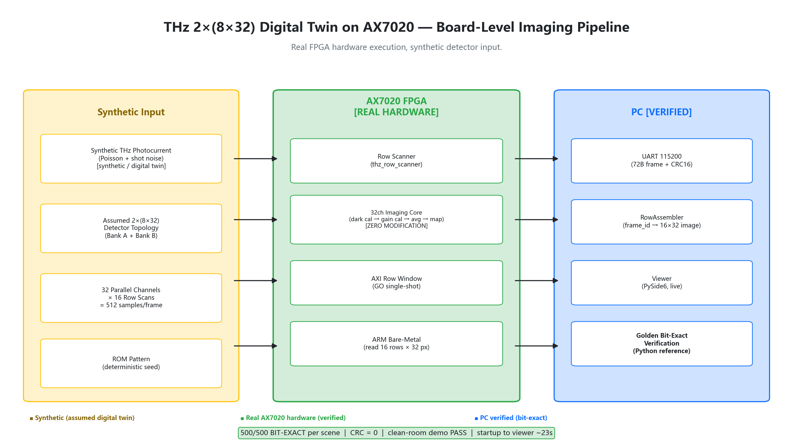
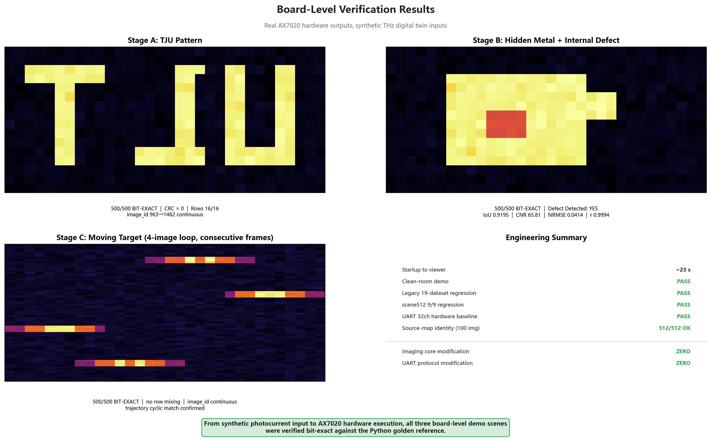

# THz FPGA Imaging PoC

A reproducible FPGA-based THz imaging research prototype with synthetic
photocurrent modeling, bit-exact RTL verification, AX7020 hardware
execution, and a 2x(8x32) digital-twin imaging demo.

## What is Real

- **AX7020 FPGA execution**: Zynq-7020 PL imaging pipeline running on hardware
- **RTL**: 7-module SystemVerilog imaging core (32-channel, parameterizable to 512)
- **ARM/AXI/UART pipeline**: bare-metal readout, 72B frame protocol, CRC16
- **Board-level captures**: real UART data, real JTAG download
- **Bit-exact verification**: every board pixel matched against Python golden reference

## What is Synthetic

- **THz detector photocurrent input**: Poisson statistics model, not real detector
- **Assumed 2x(8x32) detector topology**: engineering digital-twin assumption
- **Detector/noise parameters**: simulation assumptions, not measured values

> This repository does not claim that the synthetic THz data are measurements
> from a physical THz detector.

## Verified Results

| Test | Result |
|---|---|
| 32-channel core regression | 19/19 PASS |
| 16x32 scene (512ch) | 9/9 BIT-EXACT |
| Board: TJU pattern | 500/500 BIT-EXACT, CRC=0 |
| Board: Hidden defect | 500/500, Defect Detected=YES, IoU 0.9195 |
| Board: Moving target | 500/500, No row mixing |





## Quick Start (Simulation)

```powershell
# Windows (requires conda Python with numpy/matplotlib, WSL with iverilog)
powershell -ExecutionPolicy Bypass -File scripts\run_2x8x32_demo.ps1 tju
```

```bash
# Linux / WSL
cd tools && python run_all.py          # 19/19 regression
python scene512_validation.py          # 9/9 scene validation
python demo_2x8x32.py build            # digital twin demo
```

## Quick Start (Board)

Requires: ALINX AX7020 (Zynq-7020), JTAG programmer (Digilent JTAG-HS1),
USB-UART (CP210x), Vivado/Vitis 2025.2, conda Python.

Board artifacts (bitstream, ELF) are **not included** in this repository.
Build locally:

```bash
# Generate calibration + pattern ROM files
python fpga_ax7020/scripts/gen_mem_2x8x32.py

# Build bitstream (Vivado batch mode)
vivado -mode batch -source fpga_ax7020/scripts/build_2x8x32.tcl

# Build ARM application
cd fpga_ax7020/sw && bash build_gcc_2x8x32.sh

# Download and run (xsct)
xsct fpga_ax7020/scripts/run_board_2x8x32.tcl
```

## Architecture

```
Synthetic THz Photocurrent (Poisson)
    -> 2x(8x32) Digital Twin Model
    -> 32 Parallel Channels x 16 Row Scans
    -> [AX7020 FPGA] Row Scanner -> 32ch Imaging Core -> AXI Row Window
    -> ARM Bare-Metal (GO single-shot, 72B UART frame)
    -> UART 115200 -> PC RowAssembler
    -> 16x32 Image -> Viewer -> Golden Bit-Exact Verification
```

## Documentation

| Document | Description |
|---|---|
| [docs/README.md](docs/README.md) | Documentation index |
| [docs/ARCHITECTURE.md](docs/ARCHITECTURE.md) | System architecture and interfaces |
| [docs/RANDOM_PHOTOCURRENT_MODEL.md](docs/RANDOM_PHOTOCURRENT_MODEL.md) | Poisson photocurrent simulation |
| [docs/BOARD_DEMO_VALIDATION.md](docs/BOARD_DEMO_VALIDATION.md) | AX7020 board-level verification |
| [docs/FAILURE_BOUNDARY_ANALYSIS.md](docs/FAILURE_BOUNDARY_ANALYSIS.md) | SNR/IoU/defect vs contrast sweep |
| [docs/ZYNQ_MMIO_ORDERING_CASE.md](docs/debugging/ZYNQ_MMIO_ORDERING_CASE.md) | MMIO ordering bug case study |
| [docs/UART_SEND_SHORT_WRITE_CASE.md](docs/debugging/UART_SEND_SHORT_WRITE_CASE.md) | UART truncation case study |

## License

Apache License 2.0. See [LICENSE](LICENSE) and [THIRD_PARTY_NOTICES.md](THIRD_PARTY_NOTICES.md).
