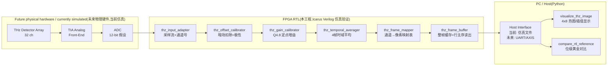

# 系统架构

## 数据链总览

## 接口约定(全链一致的 valid/ready 流)

每一级都是标准的 AXI-Stream 风格主从握手(风格参考 cepdnaclk 工程):

- `s_valid / s_ready` 同时为高 → 一拍数据被接收;反压时上级**保持**数据,无丢失。
- 采样侧通道号 `ch` 作为边带信号随数据逐级传递;
- 帧边界由 `s_last`(每帧第 32 个采样)标定;
- 平均器每 4 帧输出 1 帧(帧数参数化,2 的幂),映射器按 `channel_map.hex` 重排,
  帧缓冲按行主序流出 `(row, col, data)`。

## 定点运算规范(与 Python 黄金参考逐位一致)

| 级 | 运算 | 位宽/格式 | 截位与饱和 |
|---|---|---|---|
| offset | d = raw − dark(极性 +1)或 dark − raw(−1) | 12-bit 无符号,差 13-bit | 负差钳 0;>65535 钳 65535 |
| gain | d × gain_q | 16×16→32-bit | 右移 8 位(Q4.8)截断;>65535 钳 65535 |
| average | Σ(4 帧) | 每通道 18-bit 累加器 | 右移 2 位截断,数学上不溢出 |

Python 侧 `tools/reference_model.py` 用整数运算实现同一规则,逐位可比。

## 通道 → 像素映射

`data/calib/channel_map.hex` 定义 `channel ch → 线性像素 pidx`,
`row = pidx / COLS, col = pidx % COLS`。默认恒等映射(行主序)。
真实探测器走线顺序变化时**只改这张表**,RTL 与 Python 均无硬编码。

## 三种未来输入方式接同一条管线

1. **仿真输入(已实现)**:testbench 从 `data/rtl_in/stim.hex` 读激励流。
2. **UART 输入(P6,未实现)**:复用 cepdnaclk 工程 `uart_rx/uart_tx` 的
   分帧思路,把字节流还原成 `s_valid/s_data/s_last` 接到 `thz_input_adapter`。
3. **ADC 输入(未来硬件阶段)**:ADC 接口模块把 SPI/LVDS 采样转成同样的流。
   参考架构见 `third_party/basil_reference`(传输/寄存器/硬件三层)。
